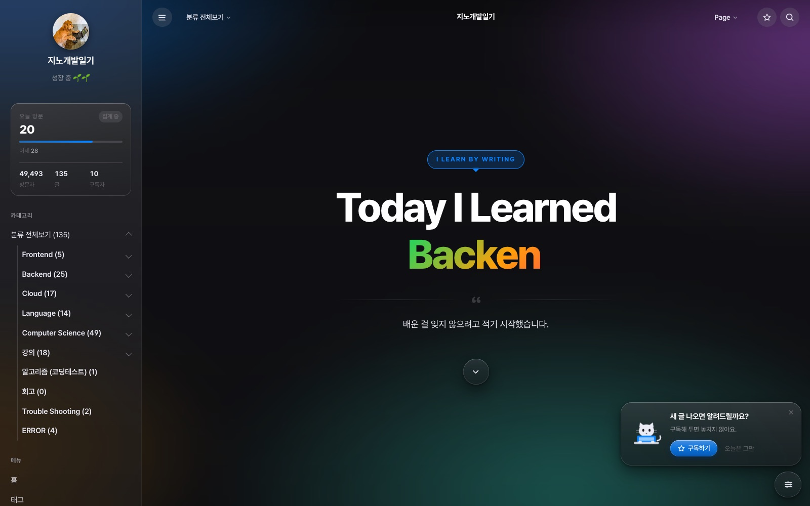
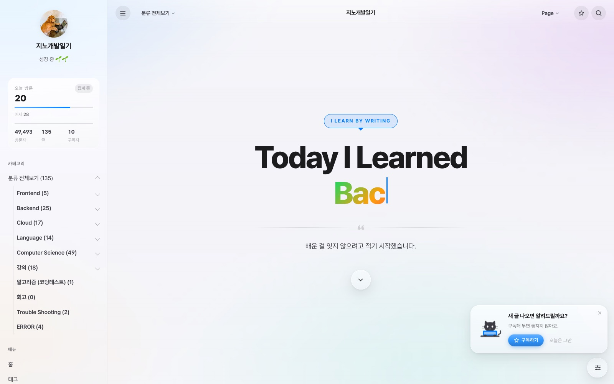
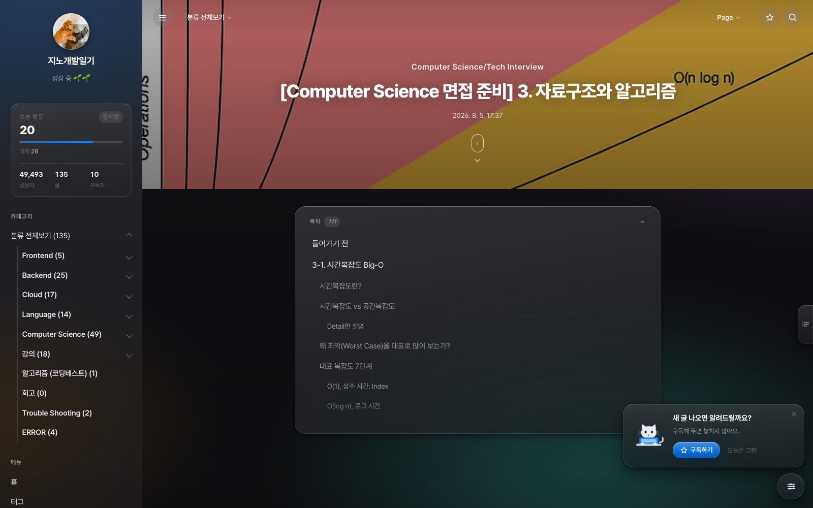
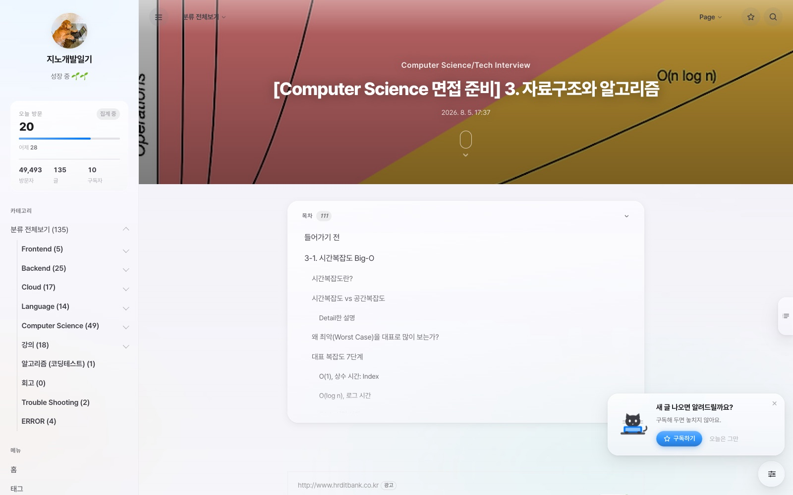

# Lucid

**Liquid Glass 디자인 언어로 만든 티스토리 스킨.** 의존성 없음 — Tailwind·Alpine·jQuery 없이 손으로 쓴 CSS와 바닐라 JS뿐입니다.

<p align="center">
  
  
</p>
<p align="center">
  
  
</p>

데모: [jinhos-devlog.tistory.com](https://jinhos-devlog.tistory.com/)

## 특징

- **진짜 굴절 유리** — `backdrop-filter`에 SVG `feDisplacementMap`을 물려 가장자리에서 빛이 꺾이고 색이 분산됩니다. Chromium에서 동작하고, 다른 브라우저는 frosted glass로 자연스럽게 내려앉습니다.
- **투명도 슬라이더** — iOS 27처럼 유리를 '선명하게 ↔ 불투명하게' 조절할 수 있습니다. 선택은 기기에 저장됩니다.
- **라이트 / 다크 / 시스템** 테마. 첫 페인트 전에 결정되어 깜빡임이 없습니다.
- **풀스크린 홈 히어로** — 타이핑되는 카테고리 이름, 그 아래 카테고리 지도 · 인기 글 · 태그 · 최근 댓글 섹션.
- **글 읽기** — 접히는 목차 + 우측 스크롤스파이, macOS 창 모양 코드블록(줄번호 · 복사 · 펼치기), 유리 액자 이미지 + 라이트박스, 표 가로 스크롤, 티스토리 에디터가 남긴 빈 문단·인라인 색상 정리.
- **대화형 댓글** — 손님은 왼쪽, 글쓴이는 오른쪽 말풍선. 답글 접기.
- **방문 지표 카드** — 오늘 방문을 어제 대비 막대와 증감으로.
- **검색 팝업**(⌘K · `/`), 카테고리 메가 패널, 하단 도크, 유성 커서, 구독 토스트.
- 접근성 — `prefers-reduced-motion`, `prefers-reduced-transparency`, `prefers-contrast`를 존중하고, 키보드 포커스 링을 유지합니다.

## 설치

1. [Releases](../../releases)에서 zip을 받거나, 이 저장소의 `skin/` 폴더를 통째로 zip으로 묶습니다.
2. 티스토리 관리 → **꾸미기 → 스킨 변경 → 스킨 등록** 에서 zip을 올립니다.
3. **꾸미기 → 스킨 편집 → 스킨 옵션** 에서 아래 값을 채웁니다.

### 스킨 옵션

| 그룹 | 옵션 | 설명 |
|---|---|---|
| 사이드바 | 사이드바 | 넓은 화면에서 사이드바 상시 노출 |
| | 카테고리 접기/펼치기 | |
| | 구독자 수 | 사이드바 지표 카드에 표시. 티스토리가 스킨에 이 값을 주지 않아 직접 적습니다. 비우면 글당 평균 조회수로 대체 |
| 블로그 | 파비콘 | 이미지 주소. 비우면 관리자에서 올린 파비콘을 그대로 씀 |
| | 관리자 메뉴바 숨기기 | 로그인한 주인에게 뜨는 글쓰기·관리 바 숨김 (기본 끔) |
| 글 | 너비 | 본문 폭(px) |
| | 목차 / 목차(Scrollspy) | |
| | 코드 하이라이팅(라이트/다크) | [highlight.js 테마 이름](https://highlightjs.org/demo) (예: `xcode`, `vs2015`) |
| | 댓글 접기/펼치기 | |
| 홈 히어로 | 말풍선 라벨 / 큰 제목 / 부제 | 첫 화면 문구. 비우면 그 줄은 숨김 |
| | 타이핑 단어 | 쉼표로 구분. 비우면 카테고리 이름을 돌려 씀 |
| | 홈 최신 글 개수 | 관리 → 블로그 → **글 목록 개수**와 같게 맞추세요. 다르면 2페이지에서 글이 건너뛰어집니다 |

### 권장 티스토리 설정

- **글 목록 개수**를 '홈 최신 글 개수'와 같게 (기본 5)
- **카테고리 글 개수 표시** 켜기 — 지표 카드의 글 수와 홈 카테고리 카드의 숫자가 여기서 옵니다
- 사이드바 모듈에 **인기 글**, **최근 댓글**, **태그**가 있어야 홈의 해당 섹션이 채워집니다

## 알아둘 것

- **콘솔의 `$ is not a function`** 은 티스토리 `common.js`의 자체 문제입니다(티스토리가 jQuery를 `noConflict`로 치운 뒤 전역 `$`를 부릅니다). 이 스킨과 무관하고 영향도 관리자 레이어 토글 하나뿐이라 jQuery를 추가로 싣지 않았습니다.
- 굴절·색분산은 `backdrop-filter: url()`을 지원하는 Chromium 계열에서만 보입니다. `color-mix()`, `linear()`, `svh` 같은 최신 CSS는 폴백을 두었습니다.
- 모바일웹(`/m`)은 티스토리가 따로 그리는 페이지라 스킨이 적용되지 않습니다. 관리 → 모바일 에서 '반응형 스킨 사용' 을 켜세요.

## 개발

`skin/` 안의 세 파일이 전부입니다.

```
skin/
├── index.xml     스킨 정보와 옵션 정의
├── skin.html     마크업 + 컨트롤러 (바닐라 JS)
└── style.css     스타일 — §01부터 §42까지 번호 매긴 섹션
```

빌드 단계가 없습니다. 고친 뒤 스킨 편집기에 붙여넣거나 zip으로 다시 올리면 됩니다.

## 크레딧

- 시작점은 [hELLO](https://github.com/pronist/hello) (Sangwoo Jeong, MIT) 입니다. 치환자 구조와 커버·옵션 정의를 물려받았고, 마크업·스타일·스크립트는 다시 썼습니다.
- 서체 [Pretendard](https://github.com/orioncactus/pretendard), 코드 하이라이팅 [highlight.js](https://highlightjs.org/).

## 라이선스

[MIT](LICENSE)
